  

  
  

### Hi, I'm Angel 👋

Analog and mixed-signal IC designer. I build data converters and clocking blocks end to end, from the spec and
transistor sizing through layout, DRC/LVS and post-layout sign-off, on India's **SCL 1.2 µm CMOS** process.
I also like using ML to fix analog errors.

#### What I've built (pre-silicon)

| Block | What it is | Key numbers |
|---|---|---|
| **8-bit SAR ADC** (Rev3.2) | R-2R DAC, dual StrongARM comparator (PMOS/NMOS picked by trial code), SAR FSM, SPI output | Up to 2 MS/s (400 kS/s with a 10 MHz pad clock), 4 V FSR, comparator offset ≤ 0.5 LSB post-layout across corners, 4×4 mm chip DRC 0 / LVS match |
| **Integer-N CP-PLL** | Starved ring VCO, PFD, matched charge pump, divider, lock detector, external loop filter | 20–50 MHz (40 MHz nominal), 30/30 PVT corners, jitter 17.5 ps nominal, 2×2 mm chip DRC 0 / LVS match |
| **NN offset-calibrated comparator** ([repo](https://github.com/angelgarg/comparator)) | Dynamic comparator with a capacitor-array trim; a derivative circuit + TDC sense the offset polarity from zero-crossing timing and a neural network picks the trim code, no manual tuning | 447.2 µm², 783 µW at 1 GHz |
| **ADC + PLL combo** | Both blocks on one 5×5 mm die, PLL clocks the ADC | DRC 0 / LVS match / antenna 0 |
| **NeuroCal** | All-digital "neurons on chip" calibration engine for the ADC + PLL | 7.59 → 7.77 ENOB, SFDR 57 → 70 dB (sim), RTL bit-exact with the C model |
| **PRESENT-80 crypto chip** | SPI-controlled lightweight block cipher, gate-level and transistor-level verification | Spectre full-chip sim PASS, ~10 mW at 5 V |

#### Projects you can open

- 🎙️ [**swar-voice-adc**](https://github.com/angelgarg/swar-voice-adc): offline voice commands on my own SAR ADC chip,
  using FPGA oversampling and on-device keyword spotting
- ⚖️ [**comparator**](https://github.com/angelgarg/comparator): neural-network-based offset calibration for dynamic
  comparators (capacitor array + TDC)
- 📈 [**nse-catalyst-scanner**](https://github.com/angelgarg/nse-catalyst-scanner): live catalyst-day detection for NSE stocks

#### Tools

Cadence Virtuoso · Spectre · ngspice · Xcelium/VCS · KLayout · Magic · Yosys · OpenROAD · Verilog/Verilog-A · Python · MATLAB

#### Interests

SAR and oversampling ADCs · PLLs and clocking · comparator offset calibration · ML for analog ICs · open-source EDA

